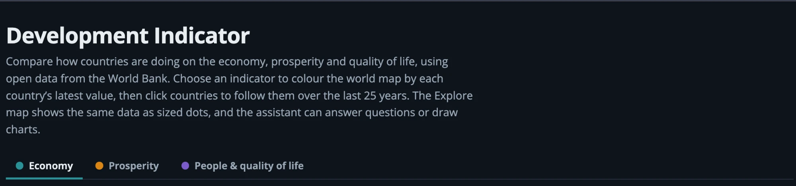
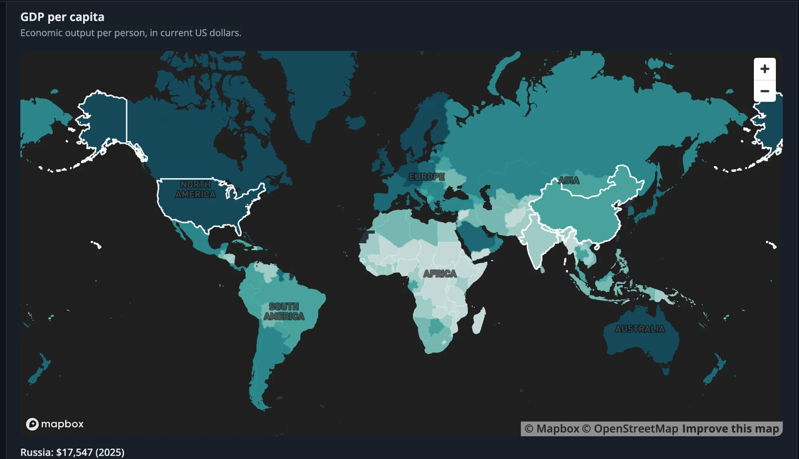
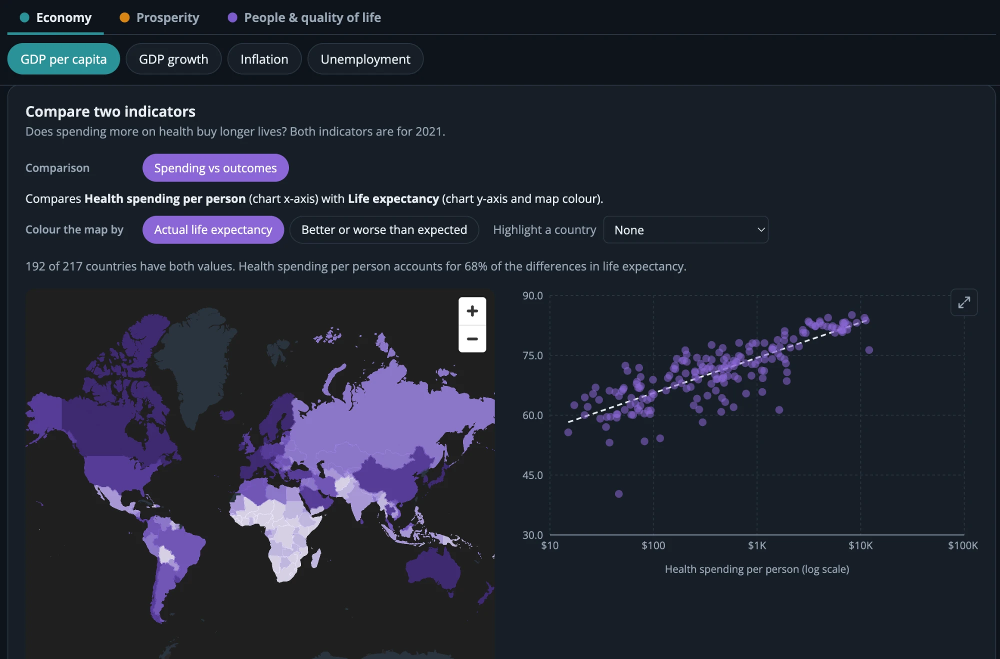
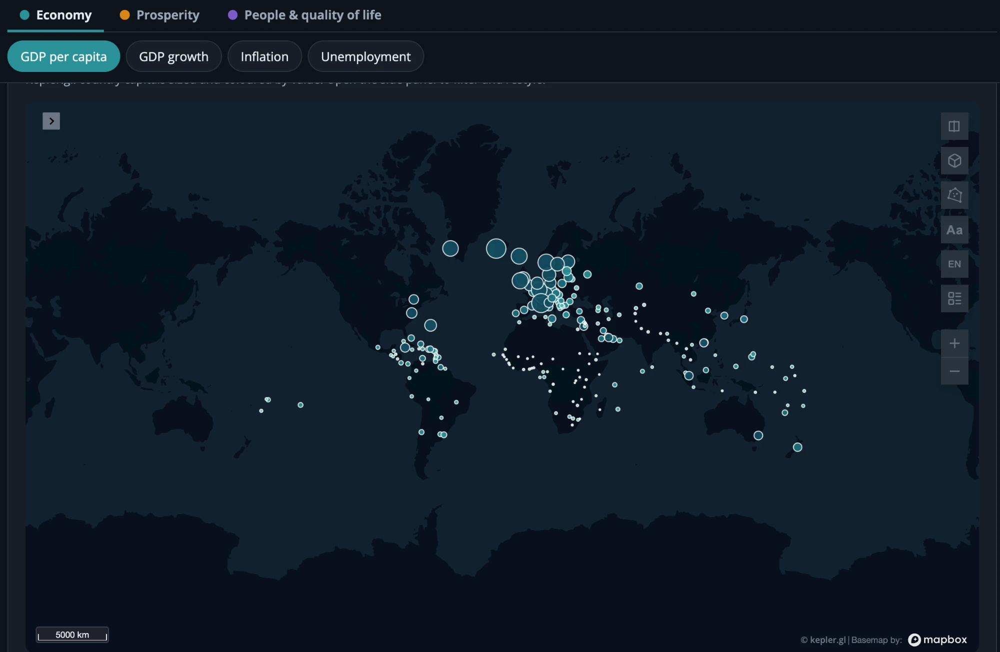
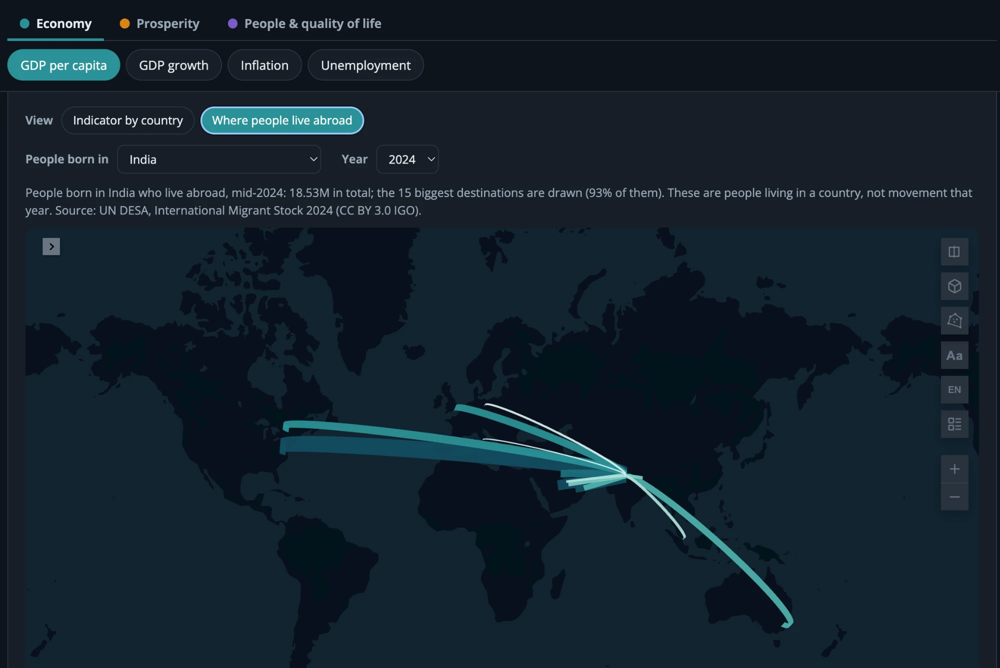
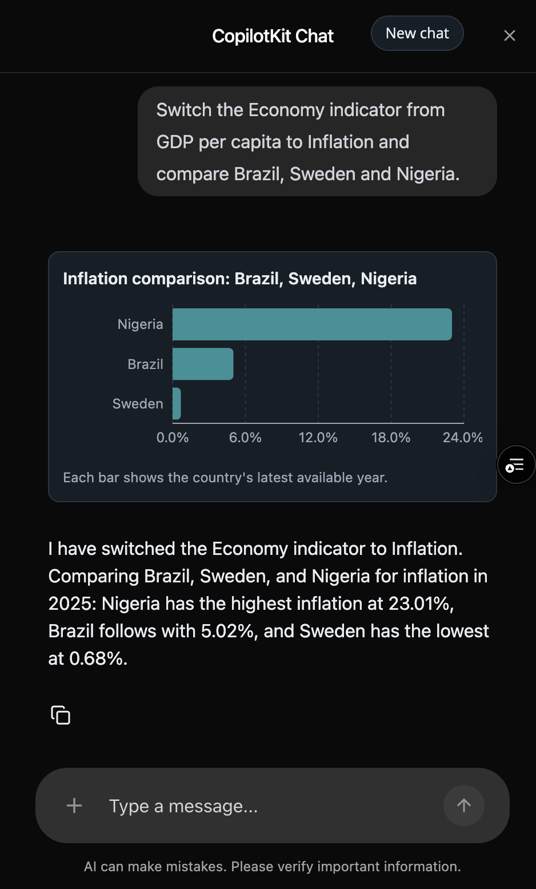

# Development Indicator

An interactive dashboard that shows how countries around the world are doing on the **economy, prosperity and quality of life**, using open data from the World Bank. Pick an indicator and see the world coloured by it, follow countries over time, compare two indicators, explore trends and migration on a second map, or just ask the built-in assistant.



## Screenshots

**World map:** every country coloured by its latest value of the chosen indicator (GDP per capita here). Click a country to follow it in the trend chart.



**Compare two indicators:** health spending vs life expectancy, with the map and scatter linked.



**Explore (Kepler.gl), indicator view:** one dot per capital, sized and coloured by the indicator.



**Explore (Kepler.gl), where people live abroad:** arcs from India to the countries its emigrants live in.



**Assistant:** ask a question, get a chart.




## What it does

### Browse indicators on a world map
- Nine indicators in three themes: **Economy** (GDP per capita, GDP growth, inflation, unemployment), **Prosperity** (GNI per capita, income inequality) and **People & quality of life** (life expectancy, population, internet use).
- Each theme has its own colour. Choosing an indicator colours every country by its **most recent available value**, so the year can differ between countries. Hover a country for its value.
- Three summary cards show the focused country, the highest country and the median across all countries.

### Follow countries over time
- Click countries on the map, or use the country picker, to add them (up to four) to the **Compare over time** chart, which shows the last 25 years of the selected indicator.

### Compare two indicators
- Pairs two indicators for every country, for one fixed year so the comparison is like for like. Today: **health spending per person vs life expectancy**.
- A world map and a scatter plot with a trend line sit side by side. Hovering or clicking a country in one highlights it in the other. The chart can be enlarged into a dialog.
- The map can show the actual outcome, or **better or worse than expected**: how far each country sits above or below what the trend line predicts for its spending.

### Explore on a Kepler.gl map
A second, more flexible map (Kepler.gl, with its own side panel for filters and restyling) with two views:
- **Indicator by country:** one dot per capital city. Show the **latest value**, or how it **changed** over the last 5, 10 or 20 years: change, % change, yearly growth, or volatility. Change views use a purple (rose) to orange (fell) scale centred on zero, so you see who is moving, not only who is rich. Rates such as inflation get absolute change and volatility only, since a percentage of a percentage misleads.
- **Where people live abroad:** arcs from a chosen country to the places its emigrants live, for years 1990 to 2024. It follows the country you are focused on in the dashboard. This is a count of people living in a country at mid-year, not people who moved that year.

### Ask the assistant
- A chat sidebar answers questions about the data on screen, can switch the indicator or add and remove countries, and can draw bar and trend charts in the conversation. The charted numbers always come from the dashboard's own data. History is kept in the browser.

## Data sources
- **World Bank Open Data** (World Development Indicators), through the public API v2. No key needed.
- **UN DESA International Migrant Stock 2024** for the migration arcs. United Nations Department of Economic and Social Affairs, Population Division (2024). Licensed CC BY 3.0 IGO. Most 2024 values are extrapolations of the 2020 estimates. A small extract is shipped as `public/data/migrant-stock.json`; see [Migration data](#migration-data).
- Country outlines come from Mapbox's free `country-boundaries-v1` tileset.

## Tech stack
React 19 and TypeScript on Vite (with the React Compiler), Recharts for charts, Mapbox GL JS and Kepler.gl for maps, CopilotKit with an OpenAI model for the assistant, Vitest and React Testing Library for unit tests, Playwright for end-to-end tests. Deployed on Vercel.

## Getting started
1. `npm install`
2. Create a public Mapbox token (starts with `pk.`) at https://account.mapbox.com/access-tokens/
3. `cp .env.example .env.local` and set:
   - `VITE_MAPBOX_PUBLIC_ACCESS`: the Mapbox token (needed for the maps)
   - `OPENAI_API_KEY`: only for the assistant; it has no `VITE_` prefix on purpose, so it stays server-side
4. `npm run dev` (restart it after changing env vars)

Without a Mapbox token the map panels show a setup message; without an OpenAI key the chat shows an error. The rest of the dashboard still works.

### Scripts
- `npm run dev`: start the dev server
- `npm run build`: typecheck and build
- `npm run lint`: ESLint
- `npm test`: unit and component tests
- `npm run test:e2e`: Playwright tests (all World Bank and migration requests are mocked, so no network or token is needed)

### Tests and CI
GitHub Actions runs lint, typecheck, build, unit tests and the Playwright tests on every pull request and push to `main` and `production`, and a guard only allows pull requests into `production` from `main`.

## Project structure
```
src/
├── api/         World Bank requests (typed, no React)
├── types/       API and domain types
├── config/      Indicators, themes, comparisons, Kepler layer and metric settings
├── hooks/       Data hooks (countries, indicator, trend, history, migration, paired indicators)
├── components/  Presentational components with co-located CSS
├── utils/       Pure helpers (formatting, colour, stats, change metrics, pair fit, migration arcs)
└── App.tsx      Owns selection state and wires data to components
server/          CopilotKit runtime (also served as a Vercel Function from api/)
scripts/         One-off data preparation (migration extract)
e2e/             Playwright tests and mocks
```

## Migration data
`public/data/migrant-stock.json` (about 170 KB) holds, for each origin country, the total living abroad and the 15 largest destinations for each of 1990, 1995, 2000, 2005, 2010, 2015, 2020 and 2024. It is built from the UN DESA workbook by `scripts/build_migrant_stock.py` (needs `pip install openpyxl pycountry`) and is only fetched when the arcs view is opened. Do not put the source `.xlsx` files under `public/`: everything there is served to visitors.

## Known limits
- Kepler.gl is an **alpha** release and heavy (about 7 MB, in its own lazy chunk).
- The comparison trend line is a straight line against the log of the first indicator. It explains about 68% of life expectancy. A second category, GDP per capita vs women in the labour force, is commented out in `config/comparisons.ts` because the straight line explains only about 1% of it (the relationship is U-shaped).
- Capital-city coordinates place the Kepler dots and arc ends; the Channel Islands have no ISO code and are skipped in the migration data.
- Mapbox and OpenAI usage is billed beyond free tiers. Use a Mapbox token restricted to your domains, and an OpenAI key with a spending limit (each question sends the visible country data to OpenAI).
- Keyboard access to map countries is limited; the country dropdown is the keyboard route.

---

## Developer notes
Details for working on the code. You do not need them to use the app.

### Data and maps
- A new indicator needs only an entry in `src/config/indicators.ts` (plus a `ValueFormat` in `utils/format.ts` if it is a new kind of number); the selector, maps, chart and assistant all read that list. Check the code on the live World Bank API first. Set `kind: 'rate'` for percentages and indexes.
- The country map joins Mapbox polygons to World Bank data on `iso_3166_1_alpha_3`. Kosovo is `XKS` in Mapbox but `XKX` in the World Bank API (`utils/countryCode.ts`); disputed or alternate-worldview polygons are filtered out. Aggregates ("World", "Arab World", ...) are removed using the country list's region id `NA`.
- `WorldMap` is lazy-loaded so the ~1.9 MB Mapbox chunk does not block first paint. The comparison panel is a second Mapbox map, so it adds one more map load.
- TypeScript is pinned to 6.0.x because `typescript-eslint` 8.72 does not yet accept TypeScript 7.

### Compare two indicators
- Categories live in `config/comparisons.ts`. Both indicators are fetched for one fixed year (2021, `fetchIndicatorForYear`); 2021 is the latest year with about 190 countries of health-spending data (checked 2026-10-23).
- `utils/pairs.ts` does the join, the least-squares fit of the outcome on `log10(driver)` and the residuals behind the "better or worse than expected" colouring.
- The scatter's hover callout is drawn from shared state, not Recharts' own tooltip, which picks the nearest point by x alone and can name a neighbouring country. The log x axis spans whole powers of ten (`utils/logAxis.ts`).
- The enlarge dialog (`ChartDialog`) is a native `<dialog>`: it closes with the cross, Escape or a click outside, and shares the hover and selection state.

### Kepler.gl panel
- `KeplerMap` has its own Redux store; the rest of the app does not use Redux. The instance is registered (`registerEntry`) before data is dispatched because Kepler silently drops actions sent before its component mounts.
- Dataset and layer settings: `utils/keplerData.ts`, `config/keplerConfig.ts`, `config/keplerMetrics.ts`. Metric maths is in `utils/changeMetrics.ts` and uses one bulk request (`fetchHistoryAll`, `useIndicatorHistory`). Each country's change uses its own first and last readings in the window. A metric that cannot be computed (too few readings, zero or negative base) is an empty cell, never 0.
- Kepler's quantize scale spans the data's min to max, so `keplerDivergingColorRange` gives equal bands over `[-extent, extent]` as a custom colour map to centre change metrics on zero. Size uses `Size: |…|` columns so a big fall draws as large as a big rise.
- Switching metric or theme restyles the existing layer in place (no remount), keeping the user's pan, zoom and tweaks.
- Kepler builds datasets asynchronously, so the arc layer and its tooltip travel with the arcs dataset's first load (as saved-map config) instead of being added afterwards. The arcs data is built by `utils/migration.ts`.
- Workarounds in `vite.config.ts` and `package.json`, to revisit on every Kepler upgrade:
  - `resolve.alias.assert` and `define['process.env.NODE_DEBUG']`: Kepler calls Node's `assert`, which Vite stubs out in the browser.
  - `overrides` pins all `@deck.gl/*` to 9.3.11: Kepler's own ranges let `widgets` float to 9.4.0, which needs a newer core and breaks the production build.

### Chat assistant (CopilotKit)
- The sidebar (`components/Assistant.tsx`, lazy-loaded, ~1.6 MB) shares what it sees with `useAgentContext` and registers what it can do with `useFrontendTool`. The runtime (`server/copilotRuntime.ts`, `gpt-4.1-mini`) runs as a Vercel Function at `/api/copilotkit` (`api/copilotkit/[...path].ts`); `npm run dev` serves the same runtime from `server/copilotDevPlugin.ts`, which caches it, so restart the dev server after changing the runtime.
- `openai` is a direct dependency and pinned with `overrides`: CopilotKit's optional peers otherwise pull `openai@4`, which wants zod 3 while Kepler's packages use zod 4. CopilotKit styles itself with a `.dark` class, so `Assistant` mirrors the OS colour scheme onto `<html>`.
- **Charts and A2UI:** the model can call `show_bar_chart` and `show_trend_chart`. It only names countries; the handlers look the numbers up in the dashboard data (`utils/chartData.ts`) or fetch the series, so values always match the app. Both take an optional `indicatorId`, so asking about another indicator charts it without moving the maps. `switch_indicator` and the comparison tools change the dashboard only on an explicit request. The runtime also enables small A2UI panels (`injectA2UITool`); the system prompt lists the allowed components because the renderer rejects invented props.
- **History:** saved in `localStorage` (`usePersistedChat`, `utils/chatHistory.ts`) and restored on reload, charts included. Only the last 10 messages are kept and sent to the model, which also caps token cost. Trimming starts on a user message so a tool result is never separated from the assistant message that requested it. The hook subscribes to the agent rather than using an effect on `agent.messages`, because the agent mutates that array in place. An empty list never overwrites saved history; only "New chat" clears it.
- **Rate limit (set in Vercel, not in code):** a Firewall rule limits each IP to 10 chat requests per minute, counting only the two routes that call the model. Create it staged in log mode first:
  ```
  vercel firewall rules add "Rate limit chat" \
    --condition '{"type":"method","op":"eq","value":"POST"}' \
    --condition '{"type":"path","op":"re","value":"^/api/copilotkit/agent/[^/]+/(run|suggest)$"}' \
    --action rate_limit --rate-limit-window 60 --rate-limit-requests 10 \
    --rate-limit-keys ip --rate-limit-action log --yes
  ```
  Review the traffic, then enforce with `vercel firewall rules edit "Rate limit chat" --rate-limit-action rate_limit --yes` and publish with `vercel firewall publish --yes`. A message that makes the model call a chart tool uses two requests. Counters are per Vercel region. The browser shows a notice on HTTP 429. `npm run dev` has no limiter.

### Themes and colour
- Themes are `TOPIC_ORDER` in `config/indicators.ts`. The selected theme is derived from the selected indicator (one source of truth), so a change made by the assistant updates the tabs too; choosing a theme selects its first indicator.
- The accent colour for chips, tabs and chart bars comes from `data-topic` on the page root (`styles/themes.css`, light and dark). Map palettes (`THEME_PALETTES`, `DIVERGING_PALETTE` in `config/theme.ts`) live in JavaScript because Mapbox and Kepler cannot read CSS variables.
- To add a theme, extend `Topic`, `TOPIC_LABELS`, `TOPIC_ORDER`, `THEME_PALETTES` and the rules in `themes.css`; `config/themes.test.ts` fails if any is missing.
- Selection and colour changes log to the browser console with `[theme]`, `[indicator]`, `[map]`, `[kepler]` and `[chat]` prefixes.
